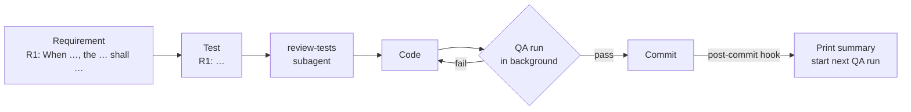

# ai-for-dummies
Agent setup for any git repository: shared rules, skills, a repository map and a tests-first workflow

## What you see
Every commit prints a summary of the repository, with daily graphs and the results of the last checks and tests

```
usage     308 prompts · 13.8 h active · since 2026-10-16
tokens    ▅█▄▁▂▁▄▂  418.4M  in <1% · out <1% · cache read 96.7% · cache write 2.9%
cost      ▅█▃▁▂▁▅▂  $141.1
energy    ██▄▁▃▁▇▂  3.5 kWh
checks    ✓ line limit  ✓ no comments  ✓ reviewed tests  ✓ shellcheck · 1.0 s
tests     ████████████████████ 178 pass · 52.0 s
```

| Row | Shows | Source |
|---|---|---|
| `usage` | prompts and active time | Claude Code session files in `~/.claude/projects` |
| `tokens` | tokens per day and the token mix | same |
| `cost` | API list price per day | [LiteLLM](https://github.com/BerriAI/litellm) prices, cached weekly |
| `energy` | minimum energy estimate per day | [EcoLogits](https://github.com/mlco2/ecologits), cached weekly |
| `checks` | `✓` passed, `✗` failed, with the files named | last QA run |
| `tests` | pass bar, with failing tests named | last QA run |

## How testing works
Requirements come first, then tests, then code. Checks and tests run in the background, so nothing ever blocks or slows a commit or push



| QA run checks | Fails when |
|---|---|
| `reviewed tests` | a test component changed since its review |
| `no comments` | a shell or module file has a comment line |
| `line limit` | a file has more than 400 lines |
| `shellcheck` | a shell file has shellcheck findings |
| `tests` | a test in `.agents/tests/` fails |
| `project tests` | the command in `.agents/test-command`, such as `npm test`, fails |

Agents run `sh .agents/hooks/qa.sh` while they work.

## Install
```sh
git clone https://github.com/fire-dragon-35/ai-for-dummies.git
sh ai-for-dummies/install.sh [--hooks] <target-repository>
```

## Skills
Claude Code: `/<skill>`. Other agents: ask by name

| Skill | Does |
|---|---|
| `context` | regenerates and loads the repository map |
| `scout` | checks toplists and news for new MCP servers, skills and AI tech |
| `grilling` | interviews you about a plan |
| `review-tests` | reviews one test component as a subagent |
| `metrics` | reports usage, cost, energy and verdicts (`--hooks`) |
| `benchmark` | compares the same prompt with and without the setup (this repository only) |
